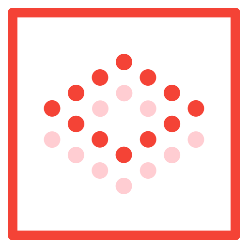
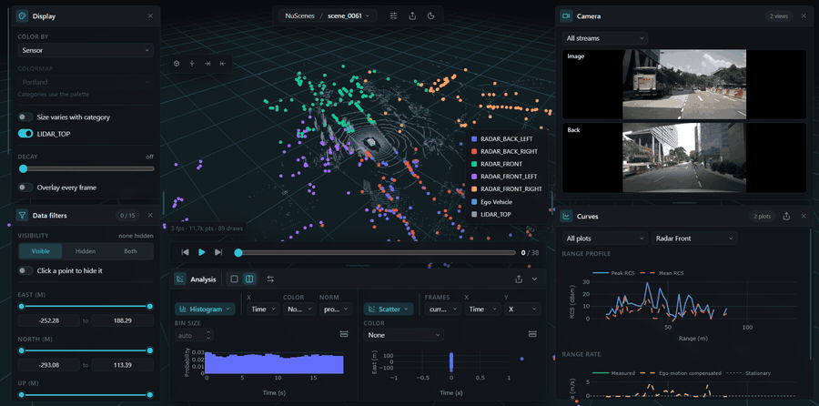
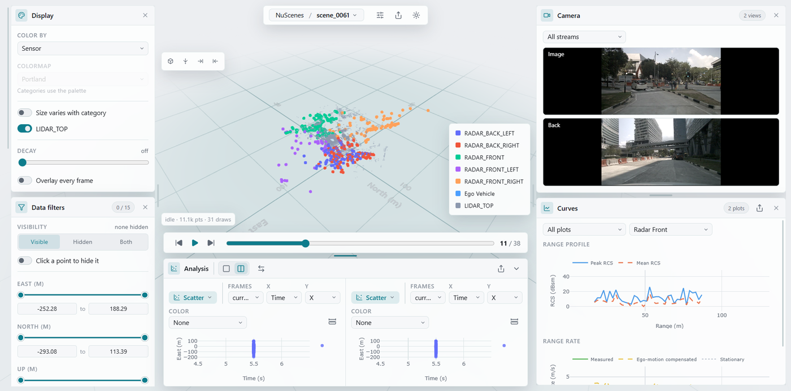
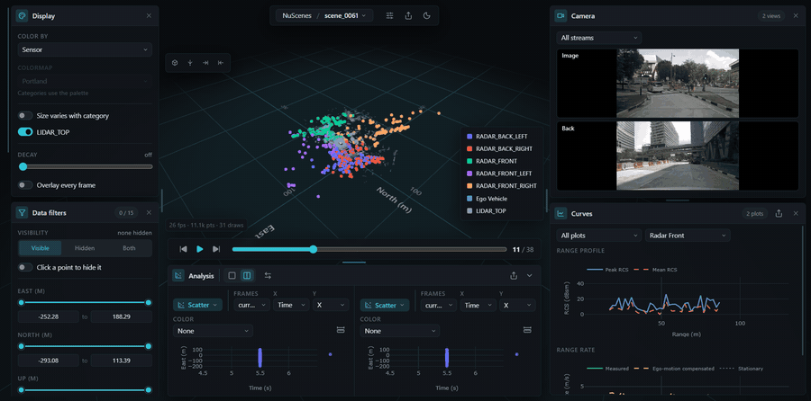
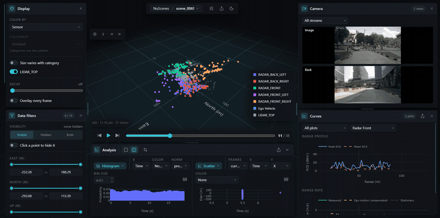
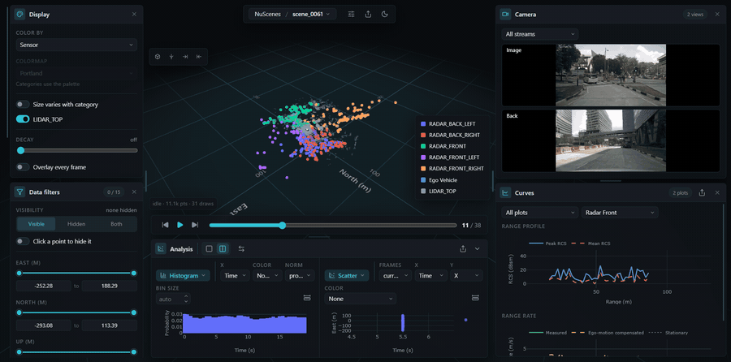
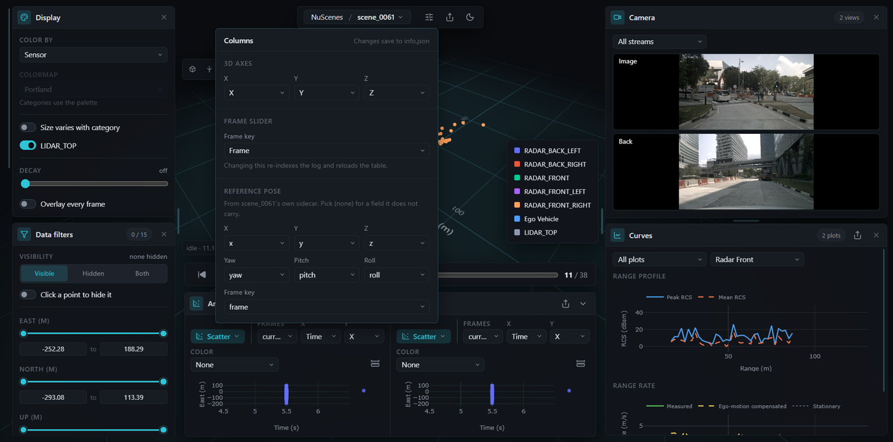
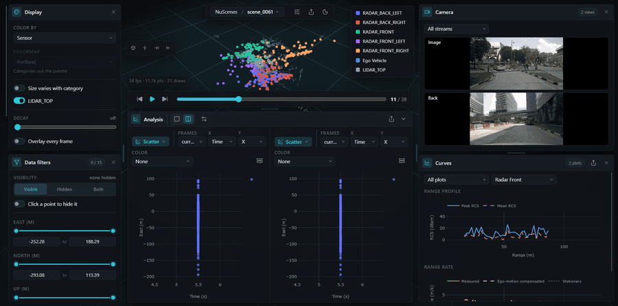
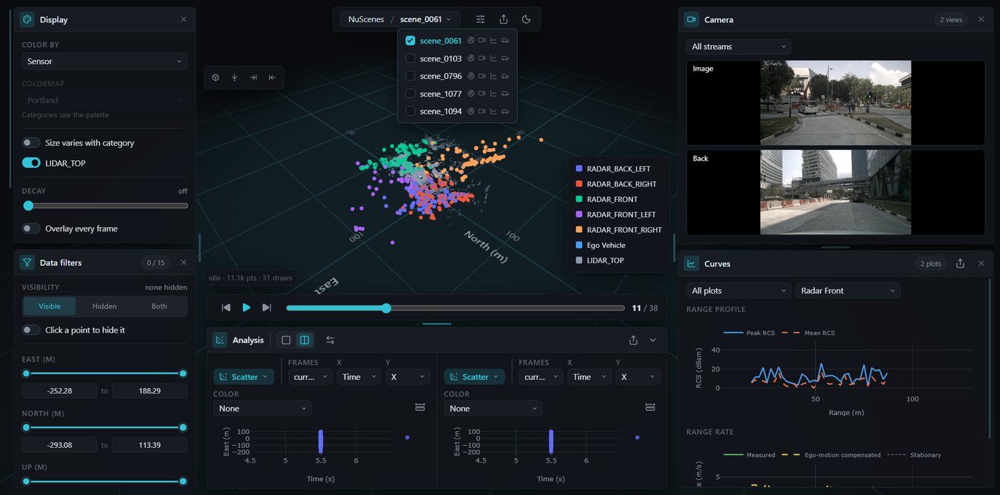
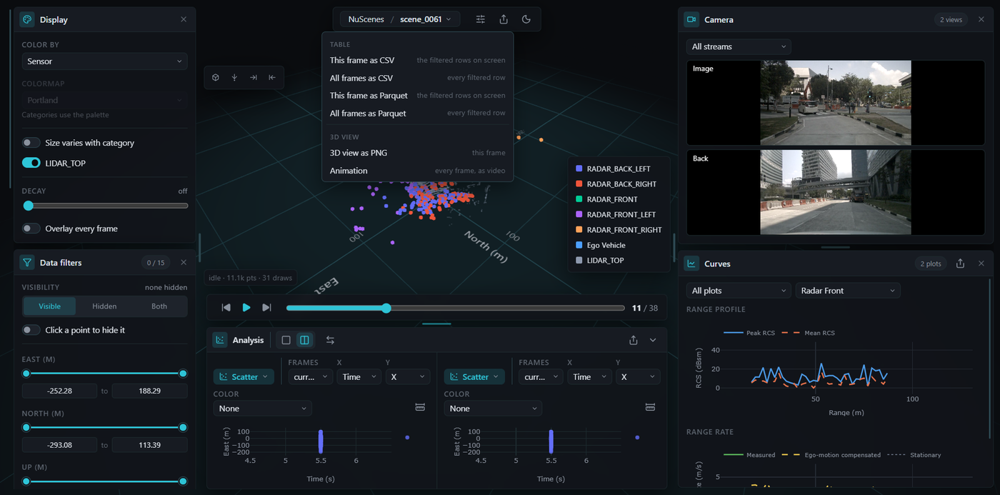

# SensorView



A desktop app for exploring multi-sensor recordings. Open a log and you get a
3D point cloud, the matching camera frame and curve plots, and a set of
statistical charts, all showing the same moment in time.

With SensorView you can:

- **Filter** the detections down to the ones that matter.
- **Inspect** a single instant in 3D, on camera and as curves, side by side.
- **Analyze** the whole recording with six linked charts.

A single frame slider and one set of filters drive everything.

## Screenshot

A nuScenes scene: the radar point cloud with the lidar backdrop and ego vehicle,
the camera frame and range profile in the inspector, and two charts in the dock.



The light theme is one click away in the top bar:



## Getting Started

Requires Node 24 or newer.

```bash
npm ci
npm run dev
```

The app opens and asks you to pick a case folder (see [Your Data](#your-data)).
To try it right away, choose `data/NuScenes`, which ships with five example
scenes.

To build a Windows installer instead:

```bash
npm run dist
```

## Using SensorView

| Region | What it does |
| --- | --- |
| **Top bar** | Pick a log from the dataset breadcrumb, combine logs, switch theme, export |
| **Left rail** | Display options and filters |
| **Canvas** | The 3D point cloud |
| **Inspector** | Camera image and curve plot for the current frame |
| **Transport** | Frame slider and play button |
| **Analysis dock** | Two slots, each showing one of the six charts |

The left rail, inspector and dock can be resized by dragging their edges
(double-click to reset) and collapsed with the chevron in their header. Your
layout and theme are remembered between runs.

To see more of the 3D scene, hide the cards in the left rail and inspector with
their close buttons and fold the dock. Small icons in the corners bring each
back.



### Keyboard shortcuts

| Key | Action |
| --- | --- |
| Space | Play / pause |
| Left / Right | Previous / next frame |
| Shift + Left / Right | Jump ten frames |
| Home / End | First / last frame |

### 3D view

Rotate, pan and zoom the point cloud, and color it by any column. A decay
slider fades earlier frames in behind the current one, and overlay mode draws
every frame at once. Hover a point to see its values, click or lasso points to
hide them. Camera presets, a color bar and a legend sit over the scene.



### Filters

Each column in your data gets a filter: a range slider for numbers, a
multi-select for categories. Every view uses the same filtered data, so a
change updates the cloud and all the charts together. Points you have hidden
can be filtered on too.



The sliders icon in the top bar maps your columns to the 3D axes, the frame
slider and the reference pose (changes are saved to `info.json`):



### Inspector

Shows the camera frame and curve plot for the current frame. Each section can
be minimized and restored from the panel bar. If a log has neither, the
inspector hides itself.

### Analysis dock

Pick any of these charts for each of the two slots:

- **2D Scatter A / B** — two independent scatter plots, with lasso and box selection
- **Histogram** — the distribution of one column, optionally split by category
- **Violin** — distribution by category
- **Parallel Categories** — how categories relate
- **Heatmap** — 2D density

Charts only compute while they are in a slot, and nothing computes while the
dock is collapsed. Drag the dock's top edge up to give the charts more room.



### Combining logs

Tick several logs in the breadcrumb to analyze them together. The first one
leads: the cloud, reference pose and exports come from it, while the camera
and curve panels show one entry per log.



### Exporting

- The filtered data as CSV
- The 3D scene as a PNG or a captioned HTML page
- The open chart as a standalone HTML page
- The whole recording as a video



---

## Your Data

A case is a folder of logs plus an `info.json` file describing them. Each log
can include:

| Data | Format | Used for |
| --- | --- | --- |
| Table | Parquet | Filtering and the charts |
| Cloud | HDF5 | 3D backdrop |
| Curves | HDF5 | Curve plot |
| Images | mp4 | Camera panel |
| Reference pose | Parquet | Ego-vehicle overlay |

SensorView only reads these files; it never changes them, except for the
`info.json` when you change an axis mapping. The exact filenames and layout are
in [DATA_FORMAT.md](DATA_FORMAT.md).

The bundled `data/NuScenes` case has five example scenes converted from
nuScenes. `data/NuScenes/build_nuscenes_case.py` is the converter used (it is
not part of the app and needs the nuScenes devkit).

---

## For Developers

```bash
npm run web        # renderer only, in a browser tab against a test fixture
npm run typecheck
npm test
npm run lint
npm run smoke -- --case data/NuScenes   # end-to-end checks inside Electron
```

Set `SENSORVIEW_OPEN_CASE` to a case path to open it at startup instead of
using the dialog.

The screenshots and GIFs under `assets/` are generated from the bundled case
by `node scripts/capture-docs.mjs`; rerun it after a UI change.

The code is split across `src/main` (window and dialogs), `src/preload` (the
bridge), `src/shared` (logic used by both sides), `src/data` (a separate process
that reads Parquet, HDF5 and video) and `src/renderer` (React UI, three.js
scene and Plotly charts). The IPC contract is in `src/shared/types.ts`. Tests
are in `test/`; see [test/fixtures/README.md](test/fixtures/README.md) for what
the fixtures pin.

## License

GPL-3.0 License - see LICENSE file for details.

## Contributing

Contributions are welcome! Please feel free to submit pull requests or open issues for bugs and feature requests.
